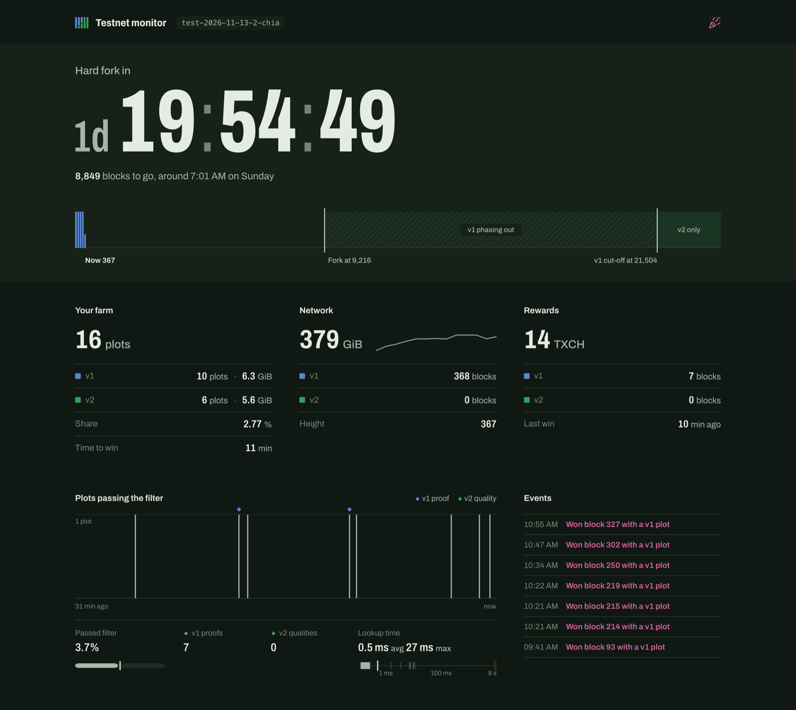

# Chia testnet monitor

A live monitor for your farm on Chia's ephemeral PoS2 testnets. It counts down to the hard fork,
shows every block from genesis to the v1 cut-off by plot version, and splits your plots,
proofs and rewards by v1 and v2. Wins get confetti.

It also checks that plot strength behaves as designed: it recomputes every plot's filter result per
signage point, compares the totals with the harvester's own log, and shows passes, proofs and wins per
strength. Running plot jobs, your peers, and a browser tab that changes colour when something is down
are on the page too.



## Run it

You need the `hardfork-testnet` branch of chia-blockchain installed and a node running, as in the
testnet instructions. Clone this repo once:

```sh
git clone https://github.com/greimela/chia-testnet-monitor
```

Then, in the same terminal you use for `chia`:

```sh
cd chia-blockchain
. ./activate
export CHIA_ROOT=~/.chia/<network_name>
python /path/to/chia-testnet-monitor/server.py --open
```

That opens http://127.0.0.1:8899. Use `--port 9000` if 8899 is taken, and Ctrl-C to stop.

When you move to a new testnet, restart it with the new `CHIA_ROOT`.

## Native app (optional)

`native/` is a GPUI port of the dashboard: same data and layout, one small process instead of a browser tab. It reads
the same `server.py`, so start that first, then `cd native && cargo run --release`. It needs a Rust toolchain
and is only tested on macOS so far; see [native/README.md](native/README.md) for details and benchmarks.

## On Windows

`pos2.ps1` runs a whole testnet setup from this folder, without WSL: the node, farmer, harvester,
wallet, solver and this monitor, plus plotting. Everything uses its own install in
`chia-blockchain\.venv` and its own data folder (`~\.chia\<network_name>`), so it never touches an
installed Chia app or `~\.chia\mainnet`. `Get-Help .\pos2.ps1 -Detailed` lists the commands.

1. **Install the testnet build** into `chia-blockchain\` inside this folder (you need Git and Python 3.11 or later):

   ```powershell
   git clone --branch hardfork-testnet https://github.com/Chia-Network/chia-blockchain.git
   cd chia-blockchain; .\Install.ps1; cd ..
   ```

2. **Create the testnet's data folder** with the network name and `initial-config.yaml` from the testnet instructions:

   ```powershell
   $N = "<network_name>"
   .\pos2.ps1 use $N
   .\pos2.ps1 chia init
   Copy-Item <path to initial-config.yaml> "$HOME\.chia\$N\config\config.yaml" -Force
   .\pos2.ps1 chia init                      # fills in the certificates for the new config
   .\pos2.ps1 chia configure --set-log-level INFO
   ```

3. **Move the daemon port.** Hyper-V and Docker often reserve ports 55387 to 55486, so the default daemon
   port 55400 can't be opened. In `~\.chia\<network_name>\config\config.yaml`, change both
   `daemon_port: 55400` lines to `daemon_port: 56400`.
   `netsh interface ipv4 show excludedportrange protocol=tcp` shows what's reserved on your PC.

4. **Add a key**, then point rewards at it:

   ```powershell
   .\pos2.ps1 chia keys generate             # or: .\pos2.ps1 chia keys add
   .\pos2.ps1 chia keys show                 # note the fingerprint and first wallet address
   .\pos2.ps1 use $N <fingerprint>           # plots and the wallet use this key
   ```

   In `config.yaml`, set both `xch_target_address` lines (farmer and pool) to your wallet address
   (`txch1...`), or your rewards go to whatever address the template had.

5. **Plot and start.** Keep to the size cap in the testnet instructions.

   ```powershell
   .\pos2.ps1 plot1 -n 2                     # v1 plots, k25, about 0.7 GB each
   .\pos2.ps1 plot2 -n 4                     # v2 plots, k28 strength 2, about 1 GB each
   .\pos2.ps1 start                          # everything, with the solver and monitor hidden in the background
   ```

   `.\pos2.ps1 dashboard` opens the monitor, `.\pos2.ps1 status` shows sync and farm, `.\pos2.ps1 stop`
   stops everything. Nothing restarts after a reboot; run `start` again. For a new testnet, repeat steps
   2 to 5; `.\pos2.ps1 use <old name>` switches back.

## What it reads

- The full node, farmer, harvester and wallet RPCs, using the certificates in your `CHIA_ROOT`.
- `log/debug.log`, for signage points, proofs, warnings and errors. Set the log level to INFO
  (`chia configure --set-log-level INFO`) or the signage-point chart stays empty.

Only the full node and farmer have to be running; the wallet, harvester and solver show up when they are.

## Good to know

- It only reads. It never sends a transaction or changes your config.
- The page is served on 127.0.0.1 only, so other machines on your network can't open it.
- v2 plots don't pass the filter until the hard fork height, so "v2 qualities" stays at 0 until then.
- v2 plots need the solver: run `chia_solver`, then
  `chia rpc farmer connect_to_solver '{"host": "localhost", "port": 8666}'`.
  The dashboard warns you if you have v2 plots and the solver isn't connected.
- No dependencies beyond what chia-blockchain already installs. The page loads the Archivo font from
  Google Fonts and canvas-confetti from jsDelivr.

## Credits

The plot strength check, plotting progress, peers table, browser tab status and the Windows script
(`pos2.ps1`) are by Brandt.

## License

Apache 2.0, like chia-blockchain. See [LICENSE](LICENSE).
